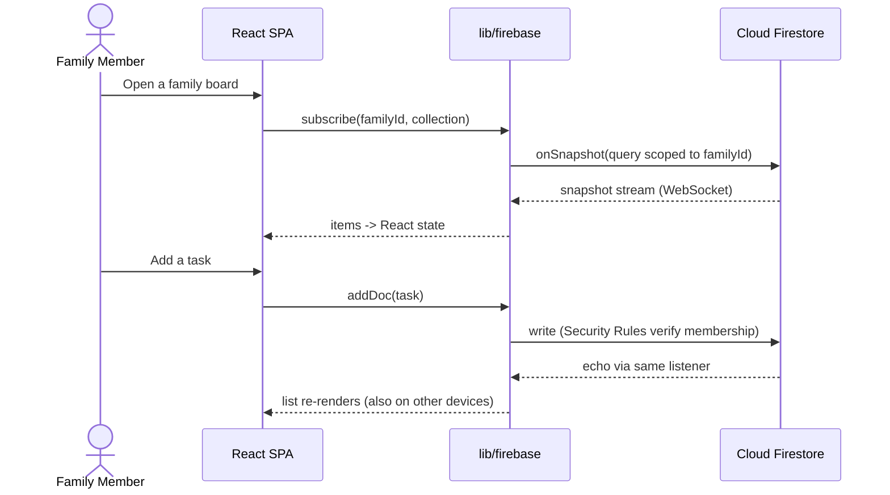

# Architecture

High-level architecture for **Flying Fridge** — a family digital noticeboard
built as a **frontend-only React SPA backed by Firebase**, packaged as a
**mobile-first PWA** with push notifications.

This document is organised around the [**C4 model**](https://c4model.com/):
we zoom in one level at a time — **Context → Container → Component** — and stop
at Component (Level 4, "Code", lives in the source tree and
[`folder-structure.md`](./folder-structure.md)).

The diagrams are **modelled as code with [LikeC4](https://likec4.dev/)** — the
single source of truth is [`architecture/flying-fridge.c4`](./architecture/flying-fridge.c4).
View them interactively:

```bash
pnpm arch          # interactive dev server (open the printed URL)
pnpm arch:build    # static site -> docs/design/architecture/dist
pnpm arch:check    # validate the model
```

Each level below names the LikeC4 **view** to open and includes a short prose
summary so this page stands alone without the tool.

> Stack decisions (React + TypeScript, Vite, pnpm, react-router,
> react-i18next, `vite-plugin-pwa`/Workbox, Firebase Cloud Messaging, Vitest +
> React Testing Library, Firebase Auth + Firestore + FCM) are recorded in
> [`docs/adr/`](../adr/). This document describes the resulting architecture and
> does not re-argue those choices.

---

## Level 1 — System Context

Who uses Flying Fridge and what it depends on. There is **no backend of our
own**: the client talks directly to managed Firebase services, which in turn
deliver push through the browser/OS push service.

- **Family Member** (person) — signs in, joins a family, and posts/reads the
  five item types across List and Calendar views.
- **Flying Fridge** (our system) — the React PWA.
- **Firebase Platform** (external) — Auth, Cloud Firestore, Cloud Messaging.
- **Web Push Service** (external) — the browser/OS channel that surfaces
  notifications on the device.

📊 **LikeC4 view:** `index` — run `pnpm arch` and open it.

---

## Level 2 — Containers

The separately deployable/runnable pieces. We own three (the SPA and two
service workers); the rest are Firebase's managed containers.

| Container | Tech | Responsibility |
| --- | --- | --- |
| **React SPA** | TypeScript, Vite, react-router, react-i18next | UI, routing, i18n, theming; all backend access funnels through `lib/firebase`. |
| **Workbox Service Worker** | `vite-plugin-pwa` / Workbox | Precache + runtime caching, offline app shell, installability. |
| **FCM Service Worker** | `firebase-messaging-sw.js` | Receives background push and shows notifications when the app isn't focused. |
| **Firebase Auth** *(ext)* | Managed | Identity (`uid`) and sign-in providers. |
| **Cloud Firestore** *(ext)* | Managed NoSQL | Datastore with real-time listeners; Security Rules enforce family membership. |
| **Cloud Messaging** *(ext)* | Managed | Push delivery (VAPID); device tokens registered from the client. |

📊 **LikeC4 view:** `containers` (`view containers of flyingFridge`).

---

## Level 3 — Components (inside the React SPA)

How the SPA container is structured internally. The rule that keeps it testable
and the backend swappable: **only `lib/firebase` imports the Firebase SDK**, and
dependencies point **inward** (`pages → features → components`,
`features → lib/firebase`).

📊 **LikeC4 view:** `spaComponents` (`view spaComponents of spa`).

### Module boundaries

| Module | Responsibility | Depends on |
| --- | --- | --- |
| `lib/firebase/` | Initialise the Firebase app from env vars; wrap Auth, Messaging, Analytics, and expose typed handles. Owns SDK **init**; feature repositories may use Firestore data APIs directly behind a repository interface. | Firebase SDK, env |
| `features/*` | One folder per domain area (`auth`, `family`, and the five item types). Owns that feature's UI, hooks, local state, and data-access calls (through `lib/firebase`). | `lib/firebase`, `components`, `i18n` |
| `pages/` | Route-level screens that compose features into a full view. Thin — orchestration, not business logic. | `features/*`, `components` |
| `components/` | Shared, presentational, app-agnostic UI and accessibility primitives. No Firebase imports. | `i18n` |
| `i18n/` | react-i18next setup, resource bundles, `en` default. | — |
| `styles/` | Global styles, theme tokens (light/dark from system), reduced-motion rules. | — |
| `test/` | Test setup/utilities for Vitest + React Testing Library. | — |

> **Landing page note:** the Requirement-1 landing page currently lives at
> `pages/landing/` as preserved raw markup + CSS rather than decomposed
> components — see [ADR-0011](../adr/0011-landing-page-static-markup.md). It will
> migrate toward `components/`/`features/` over time.

---

## Level 4 — Code

Not diagrammed here — it *is* the source. The intended directory layout and
naming conventions are in [`folder-structure.md`](./folder-structure.md); the
provisional Firestore document shapes are in [`data-model.md`](./data-model.md).

---

## Dynamic view — data flow

📊 **LikeC4 view:** `dataFlow` (a LikeC4 *dynamic view*). The sequence below is
an inline, always-rendered summary of the same interaction.

**Read (live):** a feature hook subscribes to a Firestore query scoped to the
current family → Firestore streams snapshots over a WebSocket → the hook updates
React state → List/Calendar views re-render. No polling.

**Write:** a feature action validates input and writes via a `lib/firebase`
helper → Firestore applies **Security Rules** → the write echoes back through the
same live listener (and to other family members' devices). SDK optimistic local
application makes the UI feel immediate.

**Offline:** Firestore local persistence + the Workbox-cached app shell let the
app open and queue writes offline; they sync on reconnect (see
[`pwa-and-notifications.md`](./pwa-and-notifications.md)).



---

## Auth-gated data access

Access control is enforced in **two layers**, because the client cannot be
trusted on its own:

1. **Client route/UI guard** — react-router private routes check Firebase Auth
   state. Unauthenticated users go to sign-in; users without a family go to a
   "create/join a family" flow. This is UX, **not** security.
2. **Firestore Security Rules** — the real boundary. Every family-scoped
   read/write is allowed only if the requesting `uid` is a member of that
   `familyId`. Rules reject cross-family access even if the client tries. See
   [`data-model.md`](./data-model.md).

**Flow:** sign in (Auth) → resolve family membership → scope all queries to that
`familyId` → Firestore Rules re-verify membership on every operation. Nothing
family-scoped is queried before a family context exists.

---

## Configuration

`lib/firebase` reads the web config from Vite env vars — the exact contract:

```
VITE_FIREBASE_API_KEY
VITE_FIREBASE_AUTH_DOMAIN
VITE_FIREBASE_PROJECT_ID
VITE_FIREBASE_STORAGE_BUCKET
VITE_FIREBASE_MESSAGING_SENDER_ID
VITE_FIREBASE_APP_ID
VITE_FIREBASE_MEASUREMENT_ID
VITE_FIREBASE_VAPID_KEY   (used for FCM push registration)
```

Values come from a local `.env.local` (never committed; see
[`.env.example`](../../.env.example) and
[`human-instructions/01-firebase-project-setup.md`](../../human-instructions/01-firebase-project-setup.md)).
Firebase is **not provisioned yet**; `lib/firebase` therefore checks presence
(`isFirebaseConfigured`) and initialises lazily so the app (landing page) still
runs without config, and fails fast with a clear message only when a
Firebase-backed feature is actually used.

---

## Cross-cutting concerns

- **i18n** — react-i18next, `en` default, all user-facing strings via keys.
- **Accessibility** — WCAG 2.1 AA baseline, keyboard-first, focus management,
  landmarks, reduced-motion. See [`i18n-and-accessibility.md`](./i18n-and-accessibility.md).
- **Theming** — light/dark from the system preference; reduced-motion respected.
- **Testing** — Vitest + React Testing Library, structured for TDD as features
  land. `components` and feature hooks are testable without a live Firebase.

## Deployment (high level)

The app is a static build (Vite output) plus service workers, served over HTTPS
(required for PWA + FCM). A **GitHub Actions** pipeline runs
install → lint → typecheck → test → build. Hosting target and release wiring are
defined as they are chosen (see [`docs/adr/`](../adr/) and
[`.github/workflows/`](../../.github/workflows/)).
